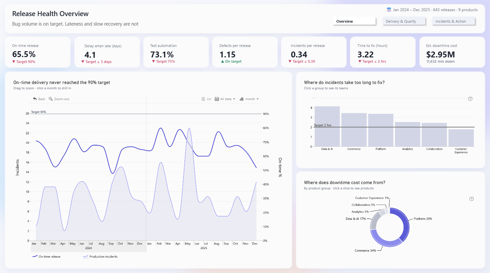
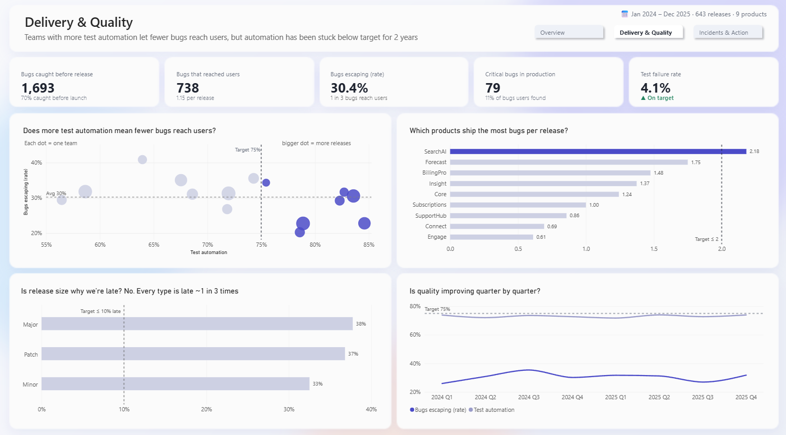
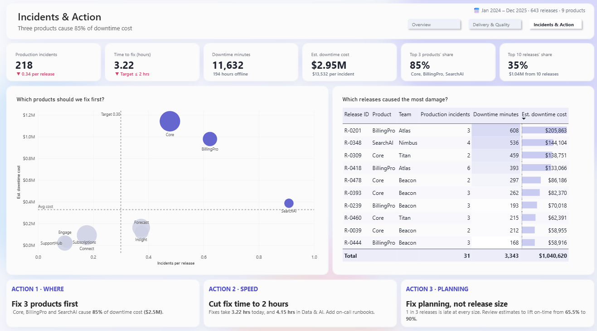
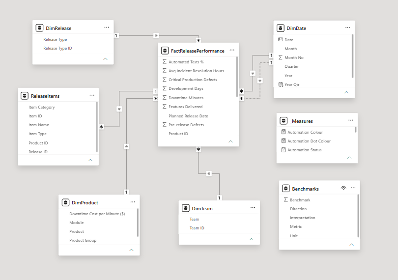

# Release Health: Software Delivery & Quality Analytics

**Power BI · DAX · Power Query · Star-schema modelling · ZoomCharts Drill Down visuals**

[Live dashboard](https://app.powerbi.com/view?r=eyJrIjoiZmYzNjQwZjItM2YwZC00M2UyLWJlMGUtMzdiMDMxM2Y2YTkzIiwidCI6IjQ2NTRiNmYxLTBlNDctNDU3OS1hOGExLTAyZmU5ZDk0M2M3YiIsImMiOjl9) · Validated entry, ZoomCharts 4U Reports Power BI Challenge (October 2026)

---

## Executive Summary

Across 643 releases over two years, **defect volume is within target (1.15 per release vs ≤ 2), but delivery and recovery are not**. Only **65.5%** of releases ship on time against a 90% target, and production incidents take **3.22 hours** to resolve against a 2-hour target. The cost is concentrated: **three products account for 85% of $2.95M in downtime cost**, and the 10 worst releases alone account for 35%.

The constraint on this engineering organisation is predictability and incident response, not code quality.



---

## Strategic Recommendations

**1. Prioritise reliability work on Core, BillingPro and SearchAI.**
These three products generate 85% of downtime cost ($2.51M of $2.95M). SearchAI also has the highest incident rate at ~0.9 incidents per release, three times the 0.30 target. Concentrating reliability effort here addresses most of the financial exposure without spreading resources across all nine products.

**2. Bring mean time to resolve down to 2 hours, starting with Data & AI.**
Five of six product groups miss the 2-hour target; Data & AI is slowest at 4.15 hours. At ~$13,500 per incident, faster resolution has a direct cost impact. Standardised on-call runbooks and escalation paths for the worst-performing groups are the lowest-cost first step.

**3. Treat lateness as a planning problem, not a release-size problem.**
Late rates are almost identical across release types (Major 38%, Patch 37%, Minor 33%), so breaking work into smaller releases will not fix delivery. The lever is estimation and scope control: target on-time delivery moving from 65.5% to 90%.

---

## Business Hypotheses & Verification

| Business question | Initial hypothesis | Result | Target | Verdict |
|---|---|---|---|---|
| Are releases delivered on time? | Delivery is broadly on track | 65.5% on time; late releases slip 4.1 days | 90%; ≤ 3 days | Rejected |
| Is defect volume the main problem? | Too many bugs are being shipped | 1.15 defects per release | ≤ 2 | Rejected |
| Are incidents resolved quickly? | Recovery is within SLA | 3.22 hrs; 5 of 6 groups miss target | ≤ 2 hrs | Rejected |
| Does test automation reduce escaped defects? | Higher automation means fewer bugs reach users | Moderate negative relationship (r ≈ -0.43); automation flat below target for 8 quarters | 75% automated | Supported, with caveats |
| Do larger releases cause lateness? | Major releases run late more often | Late rate 33–38% across all types | n/a | Rejected |
| Is downtime cost spread evenly? | Cost is distributed across products | 3 products = 85%; top 10 releases = 35% | n/a | Rejected |

---

## Dashboard Structure

The report is designed as a three-step argument for a Head of Engineering: problem, cause, action.

| Page | Question it answers | Key visuals |
|---|---|---|
| **1. Overview** | What is actually wrong? | KPI row with target status, monthly on-time trend vs incidents, resolution time by product group, downtime cost by group |
| **2. Delivery & Quality** | Why is it happening? | Automation vs escape rate by team, defects per release by product, late rate by release type, quarterly quality trend |
| **3. Incidents & Action** | Where do we act first? | Product priority matrix (incident rate vs cost), top 10 costliest releases, three recommendation cards |

| Overview | Delivery & Quality | Incidents & Action |
|---|---|---|
|  |  |  |

---

## Technical Implementation

### Data model

A star schema with a single fact table at release grain.



| Table | Role | Notes |
|---|---|---|
| `FactReleasePerformance` | Fact (1 row = 1 release, 643 rows) | Delivery, testing, defect and incident measures |
| `DimDate` | Date dimension | Marked as date table. Active relationship to `Release Date`, **inactive** relationship to `Planned Release Date` |
| `DimProduct` | Product dimension | Product → Product Group hierarchy. Downtime cost per minute merged in via Power Query (left outer join) to avoid a snowflake |
| `DimTeam` | Team dimension | Many-to-one, single-direction filter |
| `DimRelease` | Release type dimension | Major / Minor / Patch, used for the lateness-by-release-size analysis |
| `ReleaseItems` | Item-level detail | Related to the fact via `Release ID`. The redundant direct link to `DimProduct` was removed to keep one filter path |
| `Benchmarks` | Targets | **Disconnected by design**; read by measures so targets are maintained in data, not hard-coded in visuals |

### Key DAX measures

**Weighted resolution time.** Resolution hours are stored per release, but releases have different numbers of incidents. A simple average treats a release with one incident the same as a release with six. Weighting by incident count ("sum first, divide last") gives the true mean time to resolve.

```dax
Time to fix (hours) =
DIVIDE(
    SUMX(
        FactReleasePerformance,
        FactReleasePerformance[Production Incidents] * FactReleasePerformance[Avg Incident Resolution Hours]
    ),
    SUM(FactReleasePerformance[Production Incidents])
)
```

A naive average returned **0.72 hours**; the weighted figure is **3.22 hours**, over 4× higher. Reporting the naive number would have hidden the main recovery problem.

**Downtime cost.** Cost per minute differs by product, so cost is calculated row by row before aggregating.

```dax
Est. downtime cost =
SUMX(
    FactReleasePerformance,
    FactReleasePerformance[Downtime Minutes] * RELATED(DimProduct[Downtime Cost per Minute ($)])
)

Cost per Incident = DIVIDE([Est. downtime cost], [Production Incidents])
```

**Targets from a benchmark table.** Keeps business rules in one place and makes status logic reusable.

```dax
Target Resolution Hours =
CALCULATE(MAX(Benchmarks[Benchmark]), Benchmarks[Metric] = "Resolution Hours")

Resolution Status =
IF([Time to fix (hours)] <= [Target Resolution Hours], "▲ On target", "▼ Target ≤ 2 hrs")

Resolution Colour =
IF([Time to fix (hours)] <= [Target Resolution Hours], "#23845F", "#C8456A")
```

Status and colour measures drive the KPI cards through conditional formatting (field value), so every card shows its target and whether it is met.

**Concentration analysis.**

```dax
Top 3 Cost Share =
DIVIDE(
    CALCULATE([Est. downtime cost], DimProduct[Product] IN {"Core", "BillingPro", "SearchAI"}),
    CALCULATE([Est. downtime cost], ALL(DimProduct))
)

Top 10 Cost =
SUMX(
    TOPN(10, ALL(FactReleasePerformance[Release ID]), [Est. downtime cost]),
    [Est. downtime cost]
)
```

### Validation

All headline measures were reconciled against an independent calculation before building visuals:

| Measure | Value |
|---|---|
| Total releases | 643 |
| On-time release % | 65.5% |
| Time to fix (weighted) | 3.22 hrs |
| Defects per release | 1.15 |
| Defect escape rate | 30.4% |
| Production incidents | 218 |
| Downtime minutes | 11,632 |
| Downtime cost | $2,950,024 |

### Design decisions

- **One question per chart.** Each visual title is the business question it answers; no chart repeats another.
- **Restricted colour system.** Indigo highlights the point of each chart, grey is context, dashed lines are targets. KPI status uses green (on target) and rose (off target) only.
- **Purposeful drill-down.** ZoomCharts visuals let users move from product group to team or product, and zoom the timeline from years to months. Short hints under each title explain the interaction.

---

## Limitations & Next Steps

- **Correlation, not causation.** The automation–escape rate relationship is moderate (r ≈ -0.43) across 15 teams. A controlled comparison over time would be needed before committing investment on that basis.
- **Root cause of lateness.** The dataset has no estimate-vs-actual effort or scope-change data. With it, the planning recommendation could be made specific.
- **Incident severity and on-call data** would explain why Data & AI resolves incidents more slowly.

---

## Lessons Learned

- **Aggregation logic is a business decision.** The difference between a naive and a weighted average changed the headline finding. Defining how a metric is calculated matters as much as choosing it.
- **Every KPI needs a target.** A number without a benchmark cannot tell leadership whether to act. Adding target status to every card made the dashboard decision-ready.
- **Lead with the answer.** Leadership reads the conclusion first and the evidence second. Structuring the report as problem, cause, action made it usable in a single review meeting.
- **Concentration analysis drives prioritisation.** Showing that 3 of 9 products drive 85% of cost turns a broad problem into a focused plan.

---

Phillip Naing · [LinkedIn](https://www.linkedin.com/in/phillipnaing) · heyfromphillip@gmail.com
